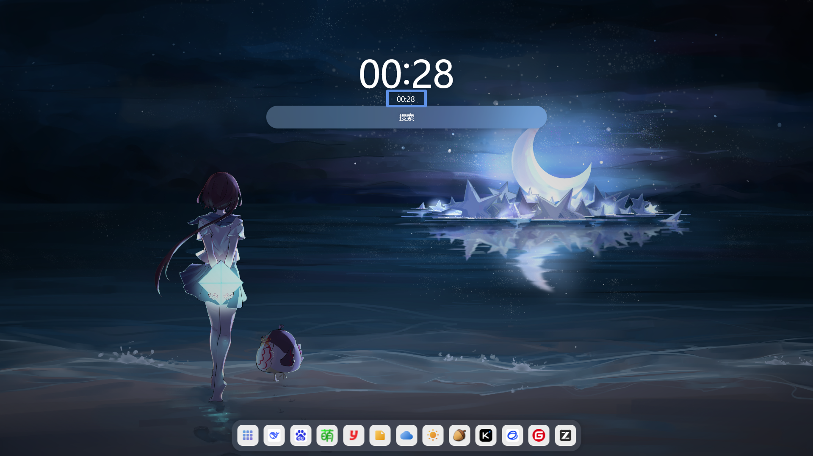

# ⏰ 时间贴（TimeStick）

> 只在你全屏时出现的时钟。不呼出任务栏、不按任何键，抬眼即见，全程不打断沉浸体验。

## 🧩 它解决了什么问题

Windows 应用进入全屏后（游戏、观影、演示等），任务栏自动隐藏，查看时间随之变成一件麻烦事：

- 鼠标移到屏幕底部唤出任务栏 —— 遮挡画面，且容易误触；
- Alt+Tab 切换窗口 —— 画面中断，部分游戏还会黑屏或卡顿；
- 掏出手机 —— 视线离开屏幕，操作节奏被打断。

这些办法的共同缺点是：**它们都在打断你正在进行的事情**。

**时间贴自动解决这个问题**：检测到前台应用进入全屏后，约 1.5 秒在屏幕右下角显示时间；退出全屏，立即隐藏。整个过程无需任何操作——手不用离开键盘鼠标，画面不中断，和抬眼看一下墙上的挂钟没有区别。

## ✨ 主要特点

### ✋ 零操作

不呼出任务栏、不按快捷键、不打断画面。进入全屏自动出现，退出全屏自动消失，用户不需要做任何事。

### 🪶 轻量

- 内存占用实测 1~7MB，峰值不超过 10MB；
- CPU 占用趋近 0%，不会影响游戏帧率；
- 主程序小于 1MB，无任何第三方运行时依赖。

### 🎨 自动反色

根据背后画面的亮度自动切换配色：浅色背景下显示黑字白底，深色背景下显示白字黑底，保证各种画面中文字都清晰可读。

### 📌 固定模式（鼠标穿透）

点击图钉 📌 进入固定模式：按钮收起，鼠标点击直接穿透到下层应用，杜绝误触。解除方式有二：鼠标停留在时间上 1.5 秒自动解除，或按 `Ctrl+Alt+T` 手动解除。

### 🧠 偏好记忆

- 时间格式：`HH:MM` / `HH:MM:SS`；
- 显示风格：默认字体 / 七段数码管。

以上选项在托盘右键菜单中切换，选择结果自动保存，重启后依然生效。

### 🤫 安静驻留

启动后静默常驻系统托盘，无主窗口；单实例保护，重复启动自动退出，不会出现两个时钟。

软件无任何联网功能，不收集、不上传任何数据。

## 🖼️ 外观

深色画面下自动反色为白字黑底，时间贴位于屏幕右下角：

| 默认字体 | 七段数码管风格 |
|---|---|
|  |  |

## 📥 下载与安装

1. 从 Gitee 发行版页面下载安装包（`TimeStick-<版本>-setup.exe`）：

   👉 **https://gitee.com/qingshangongzai/TimeStick/releases**

2. 双击运行，按向导完成安装（可选创建开始菜单与桌面快捷方式）；
3. 安装完成后运行，程序即驻留托盘开始工作。

- 系统要求：Windows 10 / 11（64 位）
- 卸载：Windows 设置 → 应用 → 找到「时间贴」→ 卸载（卸载程序会先结束运行中的实例）
- 暂不支持开机自启；如需随系统启动，可将快捷方式放入启动文件夹（`Win+R` 输入 `shell:startup` 回车）
- 首次运行如被 Windows SmartScreen 拦截，点击「更多信息」→「仍要运行」即可（开源软件无数字签名，属正常提示）

## 📖 使用说明

| 操作 | 效果 |
|---|---|
| 打开全屏应用 | 约 1.5 秒后，屏幕右下角显示时间 |
| 退出全屏 | 时间立即隐藏 |
| 鼠标悬停在时间上 | 展开半透明底板、图钉与关闭按钮 |
| 按住时间拖动 | 调整悬浮窗位置 |
| 点击图钉 | 固定模式：按钮收起，点击穿透到下层应用 |
| 悬停时间 1.5 秒 / 按 `Ctrl+Alt+T` | 解除固定，恢复可拖动 |
| 点击关闭 × | 隐藏本次悬浮窗，下次进入全屏自动恢复 |
| 托盘图标右键 | 唤出悬浮窗 / 切换时间格式 / 切换显示风格 / 查看关于 / 退出 |

## ⚠️ 已知限制

1. 目前仅检测主显示器的全屏，副屏全屏不会触发（后续版本计划支持）；
2. 极少数使用 DirectX 独占全屏模式的老游戏上无法叠加显示（当前的游戏与播放器普遍采用无边框全屏，不受影响）。

## 💛 关于项目

- 开发者：青山公仔
- 代码编写：使用 AI 编码工具 Trae 与 ZCode
- 开源协议：[木兰宽松许可证 v2（MulanPSL-2.0）](http://license.coscl.org.cn/MulanPSL2)
- 开源地址：<https://gitee.com/qingshangongzai/TimeStick>

时间贴专注的是一件小事：**在全屏时，让你不打断沉浸也能看到时间**。如果它解决了你的问题，欢迎到仓库点个 ⭐ Star，或提交 Issue 与建议。